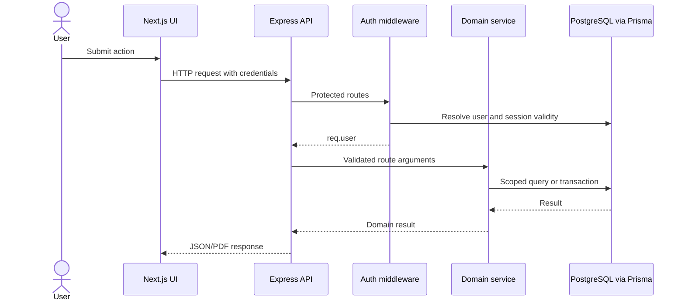

# Architecture

## Components

The frontend is a Next.js App Router application. Pages under `app/` cover landing, authentication, onboarding, dashboard, and privacy. Reusable presentation lives under `components/`; `lib/api/` contains browser fetch clients. The Express application is assembled in `vifems-backend/src/app.js`; `server.js` loads environment variables and starts the listener.

The backend route modules apply authentication and rate limits, controllers translate HTTP input to service calls, and services implement Prisma queries, dynamic PostgreSQL operations, AI blueprint validation, financial documents, email, and PDF generation. `schema.prisma` stores identities, generation drafts, workspace metadata, and financial documents. Dynamic business records live in per-module PostgreSQL tables created by the workspace service.

## Request flow

Authentication uses an HTTP-only `authToken` cookie, with optional bearer token support in the middleware. The middleware reloads the user and checks `passwordChangedAt` against JWT issue time. Workspace and finance services authorize workspace ownership before returning or mutating tenant data. Dynamic record queries include a workspace filter; relation fields are checked against records in the same workspace.

## AI blueprint to workspace

1. Authenticated client submits a business description to `POST /api/workspaces/generate`.
2. The service obtains a blueprint from the configured OpenAI-compatible provider, retries invalid responses, and validates/normalizes structure. A deterministic parser is used when no provider key is configured.
3. The validated draft is persisted in `WorkspaceGeneration` for user review and can be regenerated.
4. On launch, the backend checks generation ownership and revalidates the submitted blueprint. It creates a workspace, provisions one physical table per module, stores module metadata, and adds relation constraints where possible.
5. The dashboard fetches workspace schemas and uses them to render records and forms; CRUD is performed through the workspace API.

The metadata and table provisioning steps are not one PostgreSQL transaction: the service attempts cleanup on failure and records a failed state. Foreign-key DDL failures are currently logged and ignored, so not every declared relation is guaranteed to have a database constraint. Runtime relation validation also checks same-workspace record ownership.

## Authentication and external services

Email/password accounts use bcrypt hashes, JWT cookies, and hashed one-time password reset tokens. Google OAuth is optional and configured through Passport. Nodemailer sends welcome and reset messages through configured SMTP. AI generation is optional and uses an OpenAI-compatible HTTP endpoint when a key is present. PDFKit creates invoice and receipt documents.

## Tenant and data ownership

`Workspace.userId` establishes workspace ownership. Controllers pass the authenticated user ID into workspace and finance services. `getWorkspaceById` verifies ownership; dynamic tables include `workspace_id`, and list/detail/write operations scope to the selected workspace. Relational field values are resolved to a module in that workspace and checked against a record with the same workspace ID. Financial models store `workspaceId`, and service access starts with the ownership check.

These checks reduce cross-tenant access risk, but should receive dedicated automated API tests against unauthorized IDs. The dynamic physical tables reference the metadata `workspaces` table with cascade delete. Cross-workspace referential integrity for every financial relation and concurrent financial updates have not been established by static inspection alone.

## Financial document flow and Tra-Sync status

An authenticated workspace user creates an invoice; optional source records are looked up from the workspace's dynamic tables. A user can then record a payment with a status. `CONFIRMED` is the default in the service; confirmed records update invoice balances and create an immutable receipt snapshot within a Prisma transaction. Pending, failed, and cancelled records do not change the invoice balance and do not create receipts.

The inspected repository has no payment-provider client, payment verification endpoint, webhook route, or signature verification. An entered transaction reference is not proof of settlement. Therefore the implemented financial flow is manual bookkeeping, not Tra-Sync payment verification. The landing-page Tra-Sync animation advances through a timed client-side state sequence and labels its records as sample data; it does not show a real provider response. The page now discloses in its copy that provider verification is not implemented, although the visual animation still depicts illustrative verification stages.

## Important decisions and limitations

- Dynamic module tables preserve the schema-driven workspace model; a fixed business dashboard would discard that behavior.
- Identifiers are normalized/allowlisted before being interpolated into dynamic SQL; values are passed as parameters.
- Prisma 5 and PostgreSQL are retained.
- No authoritative deployment configuration or CI workflow was found in the inventoried repository file list.
- CORS uses an explicit configured origin plus several local development origins; production should set `CLIENT_URL` to the intended frontend origin.
